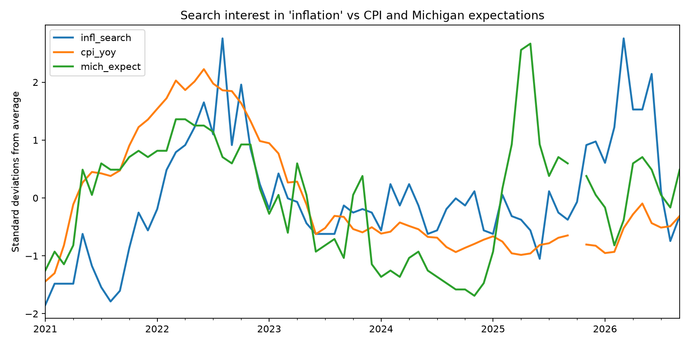
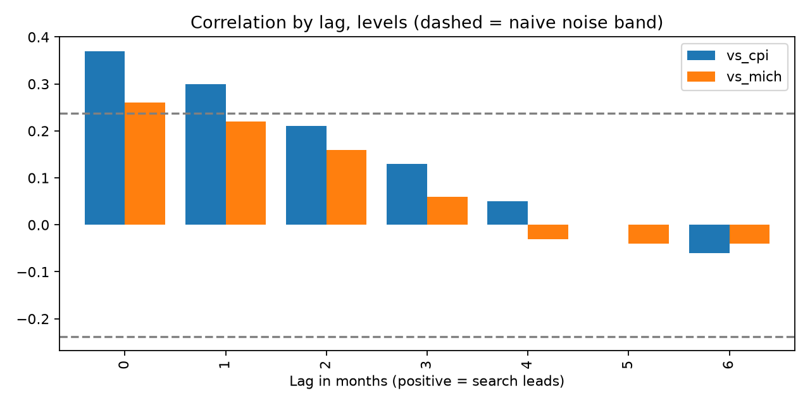
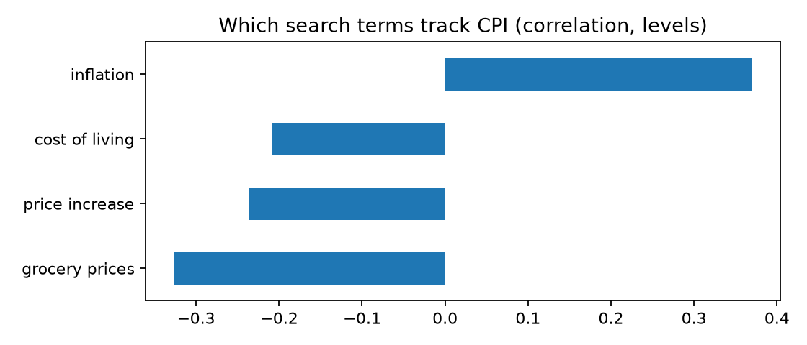

# Does search interest in "inflation" lead official inflation?

An exploratory test of whether public attention to inflation, measured by
Google Trends, moves before official US inflation or consumer inflation
expectations.

## Finding
Search interest in "inflation" moves with official CPI inflation, not ahead
of it. On levels, the correlation is 0.37 with CPI and 0.26 with Michigan
inflation expectations, strongest at zero lag and fading to zero by month
five. On month-to-month changes the relationship is weak (0.22 at best) and
it disappears in a held-out 2024-onward period. The reverse direction is stronger: CPI from one to six months earlier
correlates 0.33 to 0.39 with current search interest, with no decay, while
search interest leading CPI fades to zero by about month five. That
asymmetry is consistent with people searching after inflation shows up in
prices, though slow-moving trending series can flatten lag correlations, so
this is suggestive, not proof.

## Data
- CPI (CPIAUCSL) and University of Michigan 1-year inflation expectations
  (MICH), from FRED. CPI converted to year-over-year percent change.
- Google Trends monthly search interest, US, January 2021 to September
  2026, for four terms: "inflation", "price increase", "cost of living",
  "grocery prices".
- 68 monthly observations. October 2025 is missing because CPI was not
  published that month; lags were computed on a full monthly calendar so the
  gap does not distort them.

## Method
1. Z-scored each search term separately and compared lag correlations
   (0 to 6 months) against CPI and Michigan expectations.
2. Repeated the analysis on month-to-month changes to avoid the trending-
   series problem.
3. Checked a 2024-onward holdout period.

## Charts

## Limitations
- Measures attention, not sentiment. Search volume cannot tell worry from
  relief.
- The term "inflation" was chosen after exploring four terms and seeing it
  perform best. An average of all four tracked CPI poorly. This is
  exploratory, not a confirmatory result.
- About 68 months, with trending series. The dashed noise band in the lag
  chart is naive, so the true band is wider.
- Google Trends is sampled and normalized, so repeat pulls can differ
  slightly.
- Association only. No causal claim.

## Next
Replace search volume with transformer-based sentiment on Reddit and news
text, and compare sentiment against search attention.